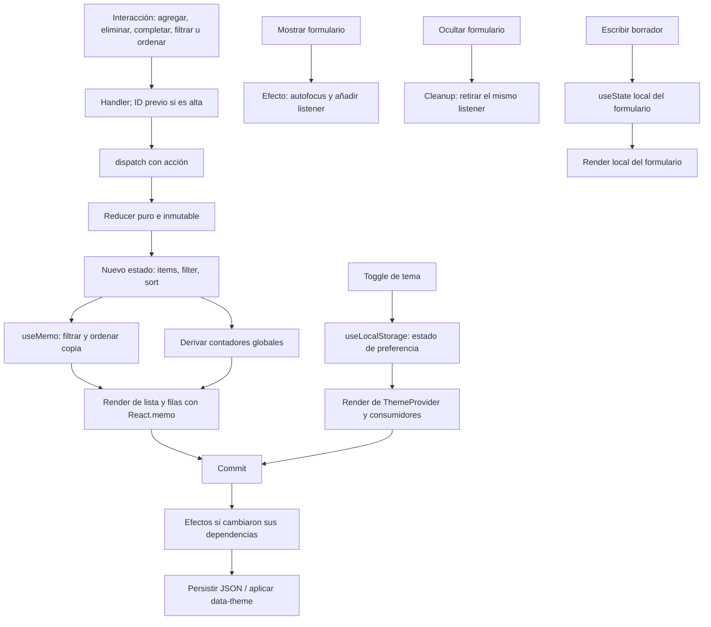

# Académico

Dashboard de gestión de tareas académicas para la Guía Práctica Semana 07, segunda parte, de Desarrollo de Aplicaciones Web. Aplicación React con estado complejo, tema persistente y efectos con limpieza verificable. Sin backend, cuentas ni base de datos.

Se revisaron las seis páginas del PDF original, incluidas las imágenes del código base de las páginas 3 a 5. Se completaron sus TODO conservando los nombres principales. El documento es una referencia académica; las acciones de publicación y entrega requieren realizarlas por separado.

## Entorno y ejecución

Entorno comprobado el 15 de octubre de 2026: **Node 24.21.0**, **npm 11.19.0**, React 19.3.1 y Vite 8.3.4. Vite declara `^20.19.0 || >=22.12.0`; el Node instalado es compatible. Referencia: [guía oficial de Vite](https://vite.dev/guide/). Las versiones reproducibles están en `package-lock.json`.

Desde PowerShell:

```powershell
cd C:\Users\Windows\Desktop\SEMANA7_DAW_PRACTICA2
npm ci
npm run dev
```

Abrir **http://127.0.0.1:5173/** (consultar la terminal si ese puerto está ocupado).

```powershell
npm run lint -- --max-warnings 0
npm test
npm run build
npm run preview
```

`preview` sirve `dist/` después del build, normalmente en http://127.0.0.1:4173/. Para detener un servidor, Ctrl+C. La tipografía de Google Fonts es opcional: si no hay conexión, se usa sans-serif. Los iconos se distribuyen con la aplicación mediante lucide-react. Prettier está disponible para mantener legible el código.

## Funcionalidades

- Cinco tareas iniciales de demostración, señaladas en la interfaz.
- Alta de tareas con ID de `crypto.randomUUID()`, título recortado y rechazo de vacío o espacios; límite de 180 caracteres en el formulario.
- Completar/reabrir, eliminar, filtrar por todas/pendientes/completadas y ordenar A–Z/Z–A con comparación española.
- Contadores globales y porcentaje de progreso derivados del estado, independientes del filtro.
- Tema claro/oscuro, recuperado de almacenamiento y aplicado con `data-theme` al documento.
- Gestor desmontable; las tareas, el filtro y el orden sobreviven a ocultar/mostrar porque el reducer sigue montado en `Dashboard`.
- Autofocus al montar y después del alta. Alt+N vuelve a enfocar la nueva tarea mientras el gestor está visible.
- Estados vacíos, etiquetas, controles nativos de teclado, foco visible y diseño adaptable. El texto introducido se representa como texto de React.

Las tareas son de sesión: **recargar reinicia los ejemplos**. Solo el tema persiste. Al ocultar se descarta el borrador del formulario. No se usa el contexto para las tareas.

## Estructura

```text
src/
  main.jsx                      # Entrada y StrictMode
  App.jsx                       # ThemeProvider y Dashboard; reducer persistente al ocultar
  styles.css                    # Interfaz adaptable y ambos temas
  contexts/
    theme-context.js            # Objeto ThemeContext
    ThemeContext.jsx            # Componente ThemeProvider
  hooks/
    useTasksReducer.js          # Reducer puro, estado inicial y ejemplos
    useLocalStorage.js          # Hook reutilizable
  components/
    TaskForm.jsx                # Estado local, validación, ref y listener con cleanup
    TaskFilters.jsx             # Filtros y selector de orden
    TaskList.jsx                # Lista derivada con useMemo
    TaskItem.jsx                # Fila con React.memo
    TaskStats.jsx               # Contadores y progreso
  test/
    setup.js
    App.test.jsx                # Pruebas funcionales y de contratos
docs/
  VALIDACION.md                 # Recorridos, Profiler y evidencias
  REQUISITOS.md                 # Matriz de trazabilidad y TODO del PDF
  evidencias/README.md          # Capturas por obtener
```

`ThemeContext` se separa de `ThemeProvider` para que el módulo JSX exporte solo componentes y satisfaga Fast Refresh con `react-refresh/only-export-components`. Los consumidores importan el objeto desde `theme-context.js` y llaman a `useContext`.

## Hooks y decisiones de estado

| Hook / API               | Archivo                                | Justificación                                                                                                              |
| ------------------------ | -------------------------------------- | -------------------------------------------------------------------------------------------------------------------------- |
| `useReducer`             | `App.jsx` + `hooks/useTasksReducer.js` | Centraliza las transiciones de `{ items, filter, sort }`; facilita comprobar las cinco acciones y su inmutabilidad.        |
| `useState`               | `TaskForm.jsx`, `App.jsx`              | Texto y error pertenecen al formulario; visibilidad pertenece al dashboard. Escribir no vuelve a renderizar toda la lista. |
| `useContext`             | `App.jsx`                              | Accede a tema y toggle compartidos, sin prop drilling.                                                                     |
| `useEffect`              | `useLocalStorage.js`                   | Guarda JSON cuando cambian `key` o `value`.                                                                                |
| `useEffect`              | `ThemeContext.jsx`                     | Aplica `data-theme` cuando cambia el tema efectivo.                                                                        |
| `useEffect`              | `TaskForm.jsx`                         | Autofocus y listener útil Alt+N; devuelve su limpieza.                                                                     |
| `useRef`                 | `TaskForm.jsx`                         | Accede al input al montar, al agregar y con Alt+N sin buscar el DOM ni almacenar nodos en estado.                          |
| `useMemo`                | `TaskList.jsx`                         | Deriva la lista a partir de `tasks` (los `items`), `filter` y `sort`.                                                      |
| `useCallback`            | `App.jsx`                              | Estabiliza eliminar/completar, pasados a filas memoizadas; `dispatch` tiene identidad estable.                             |
| `useCallback`, `useMemo` | `ThemeContext.jsx`                     | Toggle funcional estable y objeto del proveedor estable si no cambia el tema.                                              |
| Hook `useLocalStorage`   | `ThemeContext.jsx`                     | Reutiliza el contrato de preferencia persistente.                                                                          |
| `React.memo`             | `TaskItem.jsx`                         | Permite omitir renders de filas con tarea y handlers idénticos.                                                            |

`useState` podría implementar también una lista, pero se eligió `useReducer` porque hay varias transiciones relacionadas y tres subvalores con reglas compartidas. Centralizar esa lógica hace más sencillo explicarla y probarla. Los valores locales simples siguen usando `useState`; no se duplican contadores en estado.

## Acciones e inmutabilidad

| Acción   | Payload                       | Resultado                                                          |
| -------- | ----------------------------- | ------------------------------------------------------------------ |
| `ADD`    | `{ id, title }`               | Rechaza título vacío o ID repetido; agrega un objeto pendiente.    |
| `REMOVE` | ID                            | Genera un arreglo sin esa tarea.                                   |
| `TOGGLE` | ID                            | Copia solo la tarea modificada; las demás conservan su referencia. |
| `FILTER` | `all`, `pending`, `completed` | Cambia el filtro válido.                                           |
| `SORT`   | `asc`, `desc`                 | Cambia el sentido válido.                                          |

El ID se crea en `handleAdd`, **antes de `dispatch`**. El reducer no usa almacenamiento, reloj, aleatoriedad ni mutaciones. Las acciones desconocidas y los controles inválidos devuelven el estado actual. `TaskList` filtra a un arreglo nuevo antes de ordenar; nunca hace `state.items.sort()`.

## Persistencia y efectos

`useLocalStorage(key, defaultValue)` devuelve `[value, setValue]`. Su clave debe permanecer estable durante la vida del componente. Lee una sola vez por inicialización perezosa (React puede repetirla en StrictMode), recupera JSON y usa el valor por defecto si falta o está corrupto. Su setter nativo admite `setValue(previous => next)`. Un único efecto con `[key, value]` escribe JSON. Si almacenamiento está bloqueado o lleno, la interfaz continúa con estado en memoria y emite un aviso solo en desarrollo. No sincroniza pestañas ni cambios posteriores de clave.

`ThemeProvider` acepta solo `dark` como oscuro; cualquier otro valor válido se muestra como claro. El hook se ocupa de JSON y el proveedor de la interpretación del tema. El efecto del proveedor aplica el atributo; no duplica escrituras de almacenamiento ni requiere cleanup.

`TaskForm` registra una función `handleKeyDown` local al efecto y retira **esa misma referencia** en el cleanup. El efecto usa `[]` porque accede solo a la ref estable, el evento y constantes. No captura el texto del formulario. Los mensajes `[gestor]` solo existen en desarrollo; se pueden filtrar en la consola. Un Alt+N debe producir un solo mensaje mientras está montado y ninguno mientras está oculto.

Se mantiene `StrictMode`: en desarrollo puede ejecutar configuración → limpieza → configuración y repetir renders/inicializadores para detectar impurezas. Esa secuencia inicial no indica una fuga. Cada listener registrado debe tener su retiro correspondiente.

## Optimización y Profiler

`TaskItem` recibe el objeto de tarea original y las mismas funciones `handleRemove` / `handleToggle`. El padre no crea cierres distintos para cada fila. Los cierres que conectan IDs a los botones se crean **dentro** de la fila. Al cambiar una tarea, el reducer conserva las referencias de las otras. El cambio de tema aplica variables CSS y las filas no consumen el contexto.

`useMemo` evita recalcular la derivación si sus entradas no cambian; no evita por sí mismo renderizar el componente. `useCallback` conserva identidad, y `React.memo` compara props. Son oportunidades de optimización, no mediciones de mejora. Un **render** ejecuta un componente; un **commit** aplica un resultado al árbol; la **duración** es el tiempo de trabajo de render. Puede haber el mismo número de commits con menos filas renderizadas. Un filtro puede montar/desmontar filas, por lo que no es equivalente a completar una tarea.

**La comparación de rendimiento con React DevTools Profiler está pendiente. No se midieron tiempos, commits ni renders en DevTools.** El procedimiento controlado y reproducible está en [docs/VALIDACION.md](docs/VALIDACION.md).

## Flujo del estado



## Validación real

Resultados ejecutados el 15/10/2026:

| Comprobación                                      | Resultado                                                                                                                                                                 |
| ------------------------------------------------- | ------------------------------------------------------------------------------------------------------------------------------------------------------------------------- |
| `npm run lint -- --max-warnings 0`                | Correcto, sin errores ni advertencias; reglas de Hooks activas.                                                                                                           |
| `npm run build`                                   | Correcto con Vite 8.3.4; genera `dist/`.                                                                                                                                  |
| `npm test`                                        | **9 pruebas aprobadas** en Vitest + Testing Library + JSDOM.                                                                                                              |
| `npm run dev`                                     | Servidor iniciado en `127.0.0.1:5173`; petición HTTP respondió **200**.                                                                                                   |
| Recorridos funcionales                            | Verificados automáticamente: alta, vacío, toggle doble, eliminación, filtros, orden, contadores, foco, tema al reinicializar, estados vacíos y tres ciclos de desmontaje. |
| Contratos                                         | Verificados: referencias inmutables, JSON corrupto, almacenamiento bloqueado, setter funcional y listener retirado con la misma función.                                  |
| Revisión visual en navegador                      | **Pendiente**. El control de Windows se detuvo al no poder determinar la URL con suficiente confianza.                                                                    |
| Recarga real, móvil, capturas y DevTools Profiler | **Pendientes**; la reinicialización de tema y el foco sí se probaron en JSDOM.                                                                                            |

Las pruebas de DOM no sustituyen revisión visual ni una medición de rendimiento. El plan, las limitaciones y las capturas a tomar están en [VALIDACION](docs/VALIDACION.md) y [evidencias](docs/evidencias/README.md). La correspondencia de todos los requisitos y TODO está en [REQUISITOS](docs/REQUISITOS.md).

## GitHub

Estado encontrado: repositorio existente, rama `main`, commit inicial `6817b59`, remoto `origin` = `https://github.com/Yisusthegoat/SEMANA7_DAW_PRACTICA2.git`. **No se creó ningún commit ni se hizo push.** El README estaba vacío y se completó. `.gitignore` excluye dependencias, build, temporales, archivos locales y secretos.

Para revisar y guardar localmente cuando lo decidas:

```powershell
git status --short
git diff
git add .gitignore README.md package.json package-lock.json index.html eslint.config.js vite.config.js .prettierrc.json public src docs
git commit -m "Implementa dashboard Académico y validación de hooks"
git remote -v
```

No necesitas `git init` ni agregar `origin` otra vez. Solo después de confirmar que ese remoto es el destino y autorizar personalmente la subida:

```powershell
git push -u origin main
```

## Entrega RAR para ADESA

Hay WinRAR instalado en este equipo. No se creó ni subió un archivo de entrega. Después de obtener las evidencias:

1. Ejecuta lint, pruebas y build; guarda las capturas reales en `docs/evidencias/`.
2. En el Explorador selecciona `src`, `public`, `docs`, `.gitignore`, `.prettierrc.json`, `index.html`, `eslint.config.js`, `vite.config.js`, `package.json`, `package-lock.json` y `README.md`.
3. WinRAR → **Añadir al archivo…** → nombre `Academico_Semana07_Parte2.rar` → formato **RAR**. Excluye `node_modules`, `dist`, `.git`, `tmp`, `.env`, logs y secretos.
4. Abre el RAR y verifica que incluye código, configuración, lockfile y documentación. Extrae en una carpeta nueva y comprueba `npm ci`, lint, pruebas y build.
5. Sube personalmente el RAR a ADESA y el enlace de GitHub según indique tu docente.

No renombres un ZIP a `.rar`: cambiar la extensión no cambia el formato.
